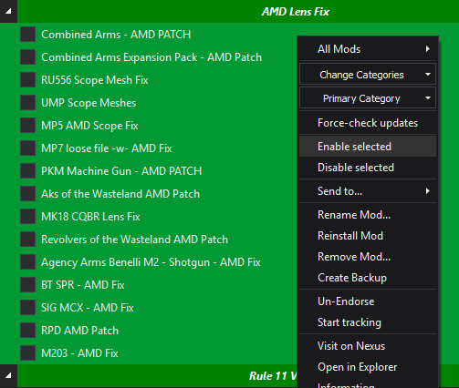
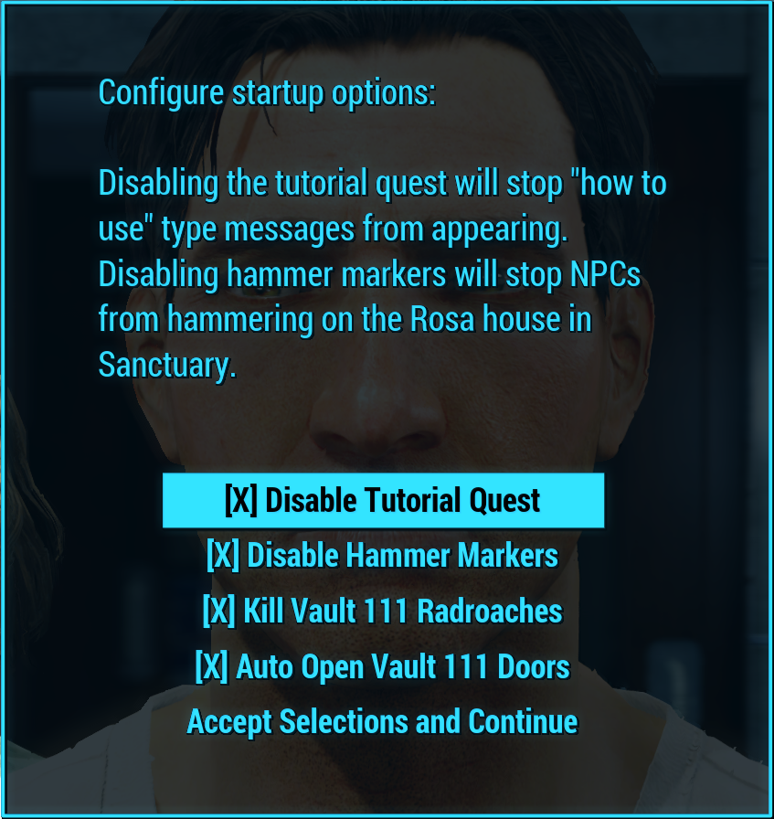
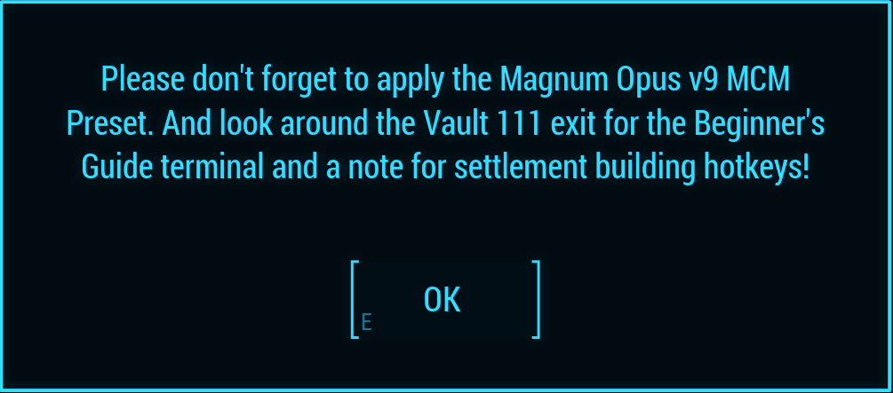
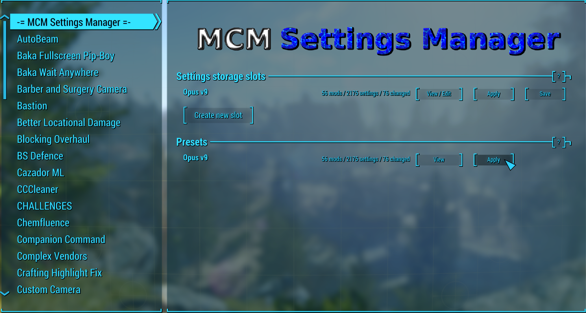

## Post-Installation Instructions

---

### Table of Contents

- [Post-Installation Instructions](#post-installation-instructions)
  - [Table of Contents](#table-of-contents)
  - [BiRaitBec Texture Optimization](#biraitbec-texture-optimization)
  - [Performance Tweaks](#performance-tweaks)
  - [AMD Users](#amd-users---particularly-people-with-a-9070-gpu---please-do-this-or-you-will-crash-a-lot)
  - [Launching the Game](#launching-the-game)
  - [A Few Quick Notes](#a-few-quick-notes)
  - [In-Game MCM Options](#in-game-mcm-options)
  - [Contact](#contact)
  - [Donate](#donate)

---

### BiRaitBec Texture Optimization

- It is my understanding that this step is problematic for Linux users, so if that's you, just skip down to [Performance Tweaks](#performance-tweaks).

This specific step is not a hard requirement, but it includes thousands of retextures in a giant mega-merge of mods. Skipping this step will not result in stability issues, but your game will look worse than those that do complete this step.

Go to [BiRaitBec Workbase Improved](https://www.nexusmods.com/fallout4/mods/57782) and download the Main File.  
Extract this archive into a blank folder, outside of a Windows protected directory (such as `D:/Workbase Improved`).  

Download the following files:

* [2a. Main Repack - Part One-23556-1-0-1565616028.7z](https://www.nexusmods.com/fallout4/mods/23556?tab=files&file_id=164245)
* [2b. Main Repack - Part Two-23556-1-0-1565980979.7z](https://www.nexusmods.com/fallout4/mods/23556?tab=files&file_id=164487)
* [2c. Main Reapack - Part Three-23556-1-0-1565605113.7z](https://www.nexusmods.com/fallout4/mods/23556?tab=files&file_id=164241)
* [Fix Vault-Window-Metal-Institute-40534-1-02-1565670781.7z](https://www.nexusmods.com/fallout4/mods/40534?tab=files&file_id=164279)
* [3. Restyle Pack - Fomod-23556-1-0-1565546849.7z](https://www.nexusmods.com/fallout4/mods/23556?tab=files&file_id=164211)

- Please note: the Restyle Pack is optional. Some people dislike the retexture of the Level Up Menu. I would encourage you to look at the mod page's images to see if you want the Restyle Pack.

**COPY** the `2a. Main Repack - Part One`, `2b. Main Repack - Part Two`, `2c. Main Reapack - Part Three`, `Fix Vault-Window-Metal-Institute`, and `3. Restyle Pack - Fomod` archives into the `D:/Workbase Improved/Repack7z` folder. **DO NOT EXTRACT, UNPACK, OR RENAME ANY OF THESE FILES.**

Now go back to your `Workbase Improved` folder again. Double click the `Installer.cmd` file to run it.  
- If the file opens up in Notepad instead of running, simply close it and instead right click on the file and choose `Open`.

Choose the output of your liking. You may use the default `PatchedBa2` folder, or navigate to your Magnum Opus installation and select `mods/[NoDelete] Workbase Optimized Textures` (recommended).  

PowerShell will now launch and begin verifying all of your archives, then repacking your .ba2 files.  
**This process may take an hour or two, depending on your hardware. For most people, it takes about fifteen minutes.**

When the installer is finished, it will automatically close itself.
- If you chose the default `PatchedBa2` folder for your output, navigate to that folder, select all the archives inside, Copy them (right `click > copy`, or `Ctrl+C`). Then navigate to `Magnum Opus/mods/[NoDelete] Workbase Optimized Textures` and paste the archives here (`right click > paste`, or `Ctrl+V`).

Due to how Wabbajack works, you only need to do this step ONCE. The `[NoDelete]` flag will prevent Wabbajack from ever deleting this mod during updates, so you will never have to redo this step unless you delete it yourself. Huzzah!

*Many thanks to Rux616 for the Workbase Improved installer, please do go show him some love and endorse his work.*

[[Top]](#table-of-contents)

---

### Performance Tweaks

Launch ModOrganizer.exe from inside your installation folder (the one you chose for the modlist when you first installed it via the Wabbajack app). There's a big bar on the right side that says `F4SE`. Click this to reveal the dropdown menu and select `Fallout Launcher`. Click `Run`. On the launcher, click `Options`. Under the `Detail` tab, click `Medium` or `High`. Do not click `Ultra`. I don't care how good your computer is; this game is old and doesn't care about your hardware. I would also recommend checking the `Windowed Mode` and `Borderless` boxes. When finished, press `OK`. You may now Exit the launcher.

The Nvidia app also really likes to "optimize" your games. It is terrible at doing so. I would strongly encourage you to disable this alleged feature. Same with AMD Adrenaline.

If your game feels choppy and you think your hardware should be performing better, try swapping between Borderless Windowed and Full Screen (whichever one you're using now, try the other). It seems pretty random on which one works best for some people.

[[Top]](#table-of-contents)

---

### AMD Users - PARTICULARLY PEOPLE WITH A 9070 GPU - PLEASE DO THIS OR YOU WILL CRASH A LOT

I do not own an AMD card, so you'll have to do this on your own.

Go to [this mod page](https://www.nexusmods.com/fallout4/mods/48053) and follow the instructions given. When prompted, your game path will be the `Stock Game` folder inside of your Magnum Opus installation folder. 

Scroll down towards the bottom of the left pane in Mod Organizer 2. There is a section of mods under a separator named AMD Lens Fix. Expand this separator and enable all of these files.  

It is also recommended to cap your FPS at 60. This can be done in the High FPS Physics Fix ini file.

---

### Launching the Game

At this point, I'd recommend restarting your PC. It's been through a lot! Give it a little reboot.

Launch ModOrganizer.exe from inside your installation folder (the one you chose for the modlist when you first installed it via the Wabbajack app). There's a big bar on the right side that says `F4SE`. Next to it is a big button that says `RUN`. This is how you will launch the game from now on. **You need to launch the game in this exact way every time in order to play with the installed mods.**

The first launch may take a few minutes, especially after the 9.6 update. The first launch has to compile shaders, cell offset cache, and some stuff for grass. Please just be patient. Subsequent launches will not be such a hassle.

It's possible you'll get the "Three cheers for the wanderers!" pop-up again. If Fallout 4 downloads more content, it will be deposited into the `Overwrite` folder in Mod Organizer 2. **Delete everything it downloads.** Everything we need has already been pulled from your Steam install by Wabbajack.

[[Top]](#table-of-contents)

---

### A Few Quick Notes

- If you want to use the optional profile with [Livelier Perks](https://creations.bethesda.net/en/fallout4/details/3b19ee36-06b9-45cb-985c-fd1720636d99/Livelier_Perks) mods, please [reference this section of the FAQ](https://github.com/LivelyDismay/magnum-opus/blob/main/faq.md#what-is-the-livelier-perks-profile-how-do-i-use-it) for details on how to do that.
- Papa Lively has a lot of cats. Your support would be immensely appreciated. I have a [Patreon](https://www.patreon.com/c/nicholasjae) and a [Ko-fi](https://ko-fi.com/livelymods) if you'd like to leave a buck or two.
- It is recommended that you leave Vault 111 prior to reporting any issues to me. Please.
- Sometimes the game can scale in odd ways. Please [read the FAQ](https://github.com/LivelyDismay/magnum-opus/blob/main/faq.md#when-i-start-magnum-opus-the-game-is-zoomed-in) to resolve this issue, and to help with any other frequently asked questions about the modlist.
- Your Pipboy flashlight will not work between the time you pick it up and the time you press the button to open the vault door. It genuinely amazes me how many people report this to me. Just press the button, it's right there.

You'll get this pop-up on character creation. Just Enable All and call it a day.

[[Top]](#table-of-contents)

---

### In-Game MCM Options

After leaving Vault 111, you'll get a friendly little pop-up. Please follow these instructions.  

**MCM Settings Manager**  
Press `Esc` on your keyboard to open the menu and find the MCM Config option. Apply the `Opus v9` Preset.  

**Please read the Terminal outside of Vault 111, and take the Holotape with you.** This serves as an in-game FAQ and will help you understand some of the new systems in Magnum Opus.

That's it! Have fun!  

[[Top]](#table-of-contents)

---

### Contact

I'm always available on [my own personal Discord Server](https://discord.gg/livelymods).

If you are joining the Discord for support, please make sure to read the rules of the server. Don't break Rule 11. If you ask questions that are already answered in the ReadMe, I will ignore you. If it's an actual issue, I will literally drop everything to go fix it as soon as I possibly can.

[[Top]](#table-of-contents)

---

### Donate

I accept donations via [Patreon](https://www.patreon.com/nicholasjae), [Ko-fi](https://ko-fi.com/livelymods), and Venmo (@Nicholas-Jae). Your generosity is appreciated immensely.

You can also support me by purchasing [Livelier Perks](https://creations.bethesda.net/en/fallout4/details/3b19ee36-06b9-45cb-985c-fd1720636d99/Livelier_Perks). There's even an alternate profile for Magnum Opus to use this Creation.

I also accept [nice comments](https://discord.gg/livelymods). They help get me through the day...

[[Top]](#table-of-contents)
